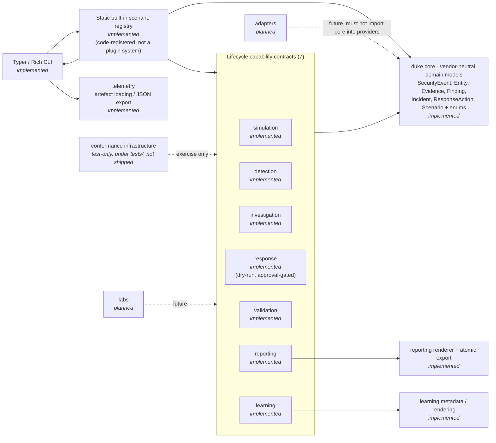

# Duke Component Architecture

This document describes Duke's component architecture as it stands today.
It complements the [lifecycle/data-flow document](lifecycle.md) and the
high-level [architecture overview](overview.md). Component boxes below are
marked **implemented** or **planned** according to their actual state as of
the current two-scenario milestone (T1078 and T1110).

The single most important rule is preserved throughout: **`duke.core` is
vendor-neutral and depends on nothing.** It never imports scenarios,
capabilities, adapters, or the CLI. Every capability component depends on
`core` (and its own result types); no capability depends on another
capability; the CLI depends on the registry, and the registry depends on
the capability packages.

## Component diagram

Dependency directions above are truthful: `core` has **no outgoing edges**.
`adapters` and `labs` are shown with dashed edges and are **planned**; no
adapter or lab code ships in this milestone.

## Components

### `duke.core` — vendor-neutral domain models (implemented)

`duke.core` holds the normalized, immutable domain models shared by every
capability: `SecurityEvent`, `Entity`, `Evidence`, `Finding`, `Incident`,
`ResponseAction`, and `Scenario`, plus the shared enums
(`EntityType`, `Severity`, `EventOutcome`, `FindingStatus`,
`IncidentStatus`, `ResponseStatus`, `ResponseRisk`, ...) and the
`DukeModel` base. These models are provider- and platform-agnostic: a
CloudTrail record, Windows event log, or EDR alert must be translated into
this shape by an adapter before it enters Duke's core. `core` depends on
nothing inside Duke; it is the single dependency hub.

### CLI — Typer / Rich command line (implemented)

The Typer-based CLI (`duke.cli.app`) exposes `version`, `simulate`,
`detect`, `investigate`, `respond`, `validate`, `report`, `learn`, and
`scenarios`. It resolves a scenario through the registry and dispatches to
the requested capability. It is the *only* place that imports
`duke.scenarios.builtins` (the composition root), avoiding a circular
import with the capability packages. Each lifecycle command independently
reloads normalized telemetry from the JSON artefact on disk; results are
not silently threaded from one command to the next.

### Static built-in scenario registry (implemented)

`duke.scenarios.registry` holds a **fixed, static** set of scenarios
registered from code — not a dynamic plugin system and no entry-point or
configuration-database discovery. A `ScenarioRegistration` pairs a
technique (`T1078`/`T1110`), slug, name, aliases, a lazy metadata loader,
and a typed `ScenarioCapabilities` record. Registration and lookup are
case-insensitive; the registry never invokes a capability during
registration, listing, or resolution. The production registry contains
exactly **two** scenarios:

- **T1078 — Valid Accounts: Compromised Identity** (`t1078_valid_accounts`)
- **T1110 — Brute Force: Password Spraying** (`t1110_brute_force`)

Both expose all **seven** lifecycle capabilities
(`simulation`, `detection`, `investigation`, `response`, `validation`,
`reporting`, `learning`). No other scenario is registered or shipped; in
particular **no T1566 scenario exists** in this milestone.

### Capability contracts (implemented)

The seven capability callables are typed in `duke.scenarios.registry` and
wired, per scenario, in `duke.scenarios.builtins`:

- **simulation** — emits a deterministic `SimulationResult`
  (`entities` + `events`).
- **detection** — infers `Finding`s from normalized events.
- **investigation** — turns a finding + telemetry into an
  `InvestigationResult` (timeline, evidence, involved entities,
  facts/assessments/questions).
- **response** — produces a **dry-run-only, approval-gated**
  `ResponsePlan`; it never executes an action.
- **validation** — reruns the detection → investigation → response
  pipeline over controlled mutations and reports a `ValidationSuiteResult`.
- **reporting** — aggregates workflow data into an `IncidentReport`.
- **learning** — returns static `LearningPath` metadata.

Each capability depends only on `core` and its own result types; no
capability imports another capability.

### Telemetry (implemented)

`duke.telemetry` loads normalized artefacts (`TelemetryArtefact`:
entities + events) from exported JSON and validates them against the
current schema version. `simulation/export.py` writes the JSON artefact
with overwrite protection.

### Reporting renderer and atomic export (implemented)

`duke.reporting.render` renders a deterministic `IncidentReport` to
Markdown; `reporting/export.py` writes it with overwrite protection
(atomic export). The renderer is scenario-agnostic — the report is a
12-section advisory document.

### Learning metadata and rendering (implemented)

`duke.learning.models` defines typed, static metadata
(`LearningStep`, `Exercise`, `Hint`, `KnowledgeCheck`, ...) and
`duke.learning.render` renders steps. The learning path is metadata only:
it never executes commands, grades, or persists progress.

### Conformance infrastructure — test-only (not shipped)

`tests/conformance/` holds reusable checks (declaration, registry,
behavioural, production) that validate both built-in scenarios and an
independent **probe scenario**. The probe lives entirely under `tests/`,
has no packaged `scenario.yaml`, is **never registered** into the
production `builtin_registry()`, and is exercised only through an isolated
`ScenarioRegistry`. Conformance code is **test-only and not shipped** in
the `duke` package.

### Adapters — planned

Provider-specific functionality (a particular SIEM, EDR, or cloud) will
live behind `duke.adapters`. None is implemented or shipped in this
milestone. Adapters translate provider data **into** Duke's normalized
models; the reverse direction (core importing a provider) remains
forbidden.

### Labs — planned

`duke.labs` will host guided end-to-end learning experiences. Per-scenario
lab documentation exists today under `docs/labs/`; the `labs` runtime
component itself is **planned**, not implemented.
