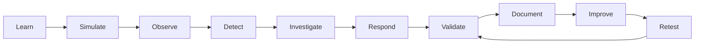
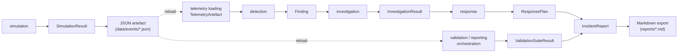

# Duke Lifecycle and Data Flow

This document explains how Duke's teaching lifecycle relates to the
concrete data flow its CLI actually implements today. It complements the
[component architecture document](components.md) and the high-level
[architecture overview](overview.md).

Two distinct things are drawn here. They are **not** the same:

1. **The product/pedagogy lifecycle** — the continuous loop Duke is built
   to teach. It is an *educational* framing, not a call graph.
2. **The currently implemented data flow** — the normalized artefacts,
   findings, and results the CLI produces from one scenario, in dependency
   order.

## 1. Product / pedagogy lifecycle

This is the continuous lifecycle described in `AGENTS.md`:
**Learn → Simulate → Observe → Detect → Investigate → Respond → Validate →
Document → Improve → Retest**. Improvements are retested so detections,
controls, and response processes are confirmed to work as intended.

Important boundaries on how these map to Duke today:

- **Learn** is a *teaching layer*, not a step the runtime executes before
  simulation. `duke learn` renders static lesson metadata; it does not run
  simulation, detection, or any other capability as a side effect.
- **Observe** is currently represented by *artefact inspection/loading*
  (reading the normalized `TelemetryArtefact` from the exported JSON
  artefact). It is **not** a registered lifecycle capability.
- **Document** is currently represented by **reporting** (`duke report`),
  which renders the deterministic advisory incident report.
- **Retest** is only *partly* represented, by **deterministic validation**
  (`duke validate`), which reruns the pipeline against controlled,
  in-memory mutations.
- **Improve** remains **planned**; there is no improvement/iteration
  workflow implemented in this milestone.

## 2. Currently implemented data flow

Key facts about this flow:

- The seven registered capabilities (**simulation, detection,
  investigation, response, validation, reporting, learning**) are
  unchanged by this milestone and are the only capability contracts the
  registry exposes.
- **The CLI does not automatically pass an in-memory result from one
  command to the next.** Most lifecycle commands independently reload the
  telemetry artefact from its JSON file and rerun their stage. Only the
  **report** command orchestrates several stages in-process (see below).
- **Report orchestration** (`duke report`) loads the artefact and runs
  **detection, validation, investigation, and response for exactly one
  finding**. It requires exactly one finding: a benign result (zero
  findings) or an ambiguous multi-finding result both skip validation and
  downstream execution entirely.
- **Response actions are proposed only and never executed.** Every
  proposed action is dry-run, requires approval, and is `status=PLANNED`.
  There is no code path that contacts an identity provider, device,
  network, file system, or security control.

### Stage-by-stage (what each emits)

| Stage | Input | Output | Writes to disk? |
|---|---|---|---|
| `simulation` | — | `SimulationResult` | JSON artefact (`data/events/*.json`) |
| `detection` | `TelemetryArtefact` | `tuple[Finding]` | no |
| `investigation` | `TelemetryArtefact`, `Finding` | `InvestigationResult` | no |
| `response` | `TelemetryArtefact`, `InvestigationResult` | `ResponsePlan` | no (proposals only) |
| `validation` | `TelemetryArtefact` | `ValidationSuiteResult` | no |
| `reporting` | artefact + `Finding` + `InvestigationResult` + `ResponsePlan` + suite | `IncidentReport` | Markdown (`reports/*.md`) |
| `learning` | — | `LearningPath` metadata | no |

All artefact and report paths under `data/events/` and `reports/` are
gitignored; they are disposable outputs of a **defensive**, synthetic
local demonstration.
